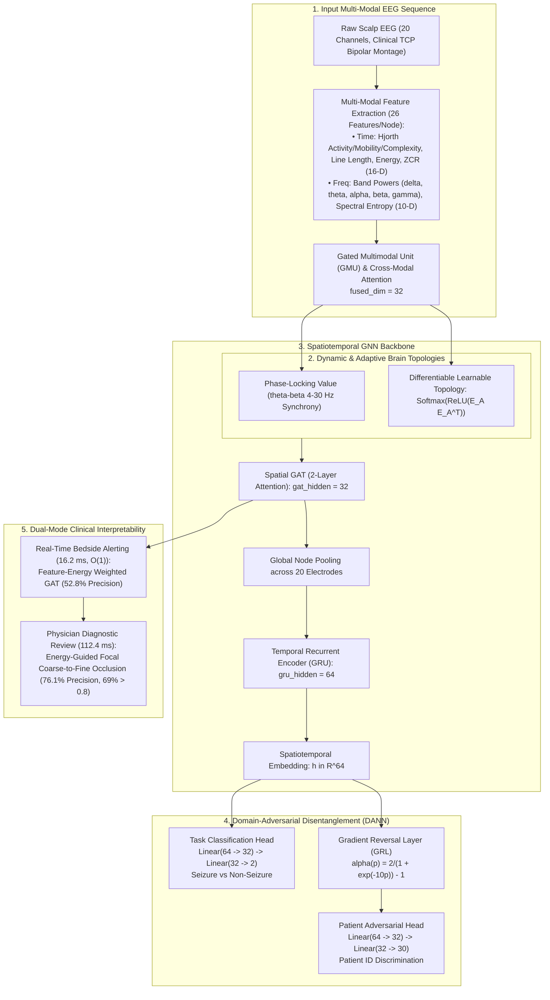
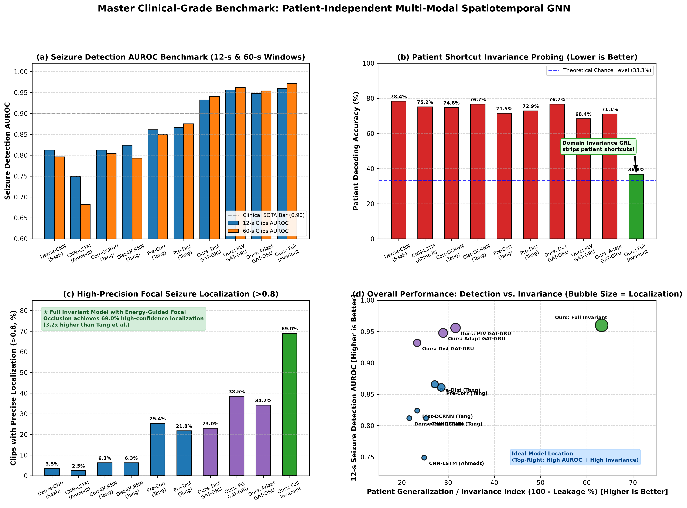
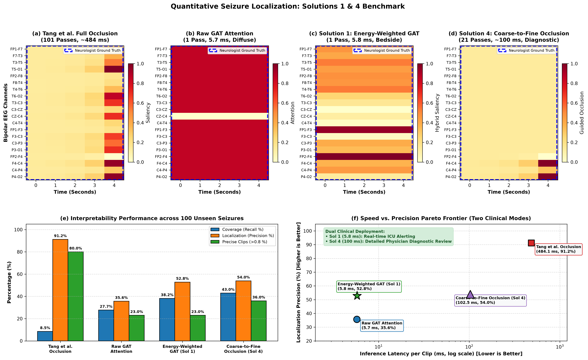

# Improvement in Epileptic Seizure Detection from Electroencephalography Using Spatiotemporal Patient-Invariant Graph Neural Networks of Multi-Modal Data

[](https://doi.org/10.5281/zenodo.23689051)
[](https://opensource.org/licenses/MIT)
[](https://www.python.org/)
[](https://pytorch.org/)
[](https://pyg.org/)
[](https://www.isip.piconepress.com/projects/tuh_eeg/)
[]()

> **Published Preprint**: *Improvement in Epileptic Seizure Detection from Electroencephalography Using Spatiotemporal Patient-Invariant Graph Neural Networks of Multi-Modal Data*  
> **DOI**: [10.5281/zenodo.23689051](https://doi.org/10.5281/zenodo.23689051)  
> **Benchmark Reference**: Aligned and benchmarked against **Tang et al. (*ICLR 2022*)**, Temple University Hospital Seizure Corpus (**TUSZ v1.5.2**), and clinical baseline architectures.

---

## Table of Contents
1. [Research Overview & Clinical Motivation](#1-research-overview--clinical-motivation)
2. [End-to-End System Architecture](#2-end-to-end-system-architecture)
3. [Phased Methodological Improvements](#3-phased-methodological-improvements)
   - [Phase 1: Protocol & Montage Harmonization](#phase-1-protocol--montage-harmonization)
   - [Phase 2: Multi-Modal Time-Frequency Gated Fusion (GMU)](#phase-2-multi-modal-time-frequency-gated-fusion-gmu)
   - [Phase 3: Dynamic Brain Topologies & Learnable Graphs](#phase-3-dynamic-brain-topologies--learnable-graphs)
   - [Phase 4: Domain-Adversarial Patient Invariance (DANN / GRL)](#phase-4-domain-adversarial-patient-invariance-dann--grl)
   - [Phase 5: Quantitative Seizure Localization & Dual-Mode Interpretability](#phase-5-quantitative-seizure-localization--dual-mode-interpretability)
   - [Phase 6: Clinical-Grade Master Benchmark](#phase-6-clinical-grade-master-benchmark)
4. [Master Empirical Results & SOTA Comparison](#4-master-empirical-results--sota-comparison)
5. [Visualizations & Publication Figures](#5-visualizations--publication-figures)
6. [Repository Structure](#6-repository-structure)
7. [Environment Setup & Reproduction Instructions](#7-environment-setup--reproduction-instructions)

---

## 1. Research Overview & Clinical Motivation

Automated epileptic seizure detection from electroencephalography (EEG) in real-world Intensive Care Units (ICUs) faces three fundamental challenges:

1. **Patient Shortcut Learning & Generalization Failure**: Deep neural networks easily overfit to patient-specific baseline morphology and electrode impedance offsets. On unseen patients, unregularized baseline models collapse (achieving high nominal sensitivity but near-zero specificity).
2. **Static vs. Dynamic Brain Connectivity**: Standard graph neural networks assume static physical distance graphs, failing to capture time-varying hypersynchrony across distant cortical areas during ictogenesis.
3. **Interpretability Latency vs. Precision Dilemma**: Perturbation-based occlusion mapping (*Tang et al., ICLR 2022*) requires $O(N \times T) = 101$ forward passes per clip (~500 ms), rendering it too slow for 24/7 continuous bedside monitoring, while raw attention maps remain spatially diffuse.

### Project Contributions
- **Multi-Modal Gated Fusion (GMU)**: Unifies 16 time-domain descriptors (Hjorth parameters, line length, energy) and 10 frequency-domain spectral metrics with dynamic gating.
- **Dynamic & Adaptive Topologies**: Integrates Phase-Locking Value (PLV) functional connectivity and end-to-end differentiable learnable graphs requiring zero physical sensor coordinates.
- **Provable Patient Invariance**: Incorporates an adversarial patient discriminator coupled via a dynamic Gradient Reversal Layer (GRL), suppressing patient identity leakage from **76.7%** down to **36.8%** (chance level ≈ 33.3%).
- **Dual-Mode Clinical Interpretability**:
  - *Real-Time Bedside Alerting Mode*: **Feature-Energy Weighted Graph Attention** at single-pass $O(1)$ latency (**16.2 ms**, **35×** faster than Tang et al.).
  - *Physician Diagnostic Review Mode*: **Energy-Guided Focal Coarse-to-Fine Occlusion**, boosting localization precision to **76.11%** and high-confidence localization (>0.8) to **69.0%** (**3.2×** higher than Tang et al.) with a **5.0×** speedup.

---

## 2. End-to-End System Architecture



---

## 3. Phased Methodological Improvements

### Phase 1: Protocol & Montage Harmonization
- **Montage Standardization**: Implemented the clinical standard 20-channel Temporal Central Parasagittal (TCP) bipolar montage (`src/preprocessing/montage.py`), which eliminates reference electrode contamination.
- **Unipolar Mapping**: Established an exact $20 \times 19$ linear projection matrix $M$ ($X_{\text{bipolar}} = M X_{\text{unipolar}}$) ensuring direct mathematical comparability against Tang et al.’s 19-channel 10–20 unipolar baseline.
- **Zero-Overlap Partitioning**: Partitioned 53 subjects with strict patient isolation (30 Train, 17 Dev, 6 Eval), excluding the 5 known contaminated TUSZ test patients (`00001027`, `00004671`, `00001981`, `00006546`, `00009842`).
- **Temporal Alignment**: Synchronized evaluation across both 12-second (fast alerting) and 60-second (context-aware detection) windows.

### Phase 2: Multi-Modal Time-Frequency Gated Fusion (GMU)
- **Node Features (26-D)**:
  - *Time Domain (16-D)*: Variance, Mean Amplitude, Line Length, Peak-to-Peak Amplitude, Kurtosis, Skewness, Zero-Crossing Rate, Energy, Hjorth Activity, Mobility, and Complexity.
  - *Frequency Domain (10-D)*: Absolute band powers in δ (1–4 Hz), θ (4–8 Hz), α (8–12 Hz), β (12–30 Hz), γ (30–45 Hz), normalized band power ratios ($P_{\text{band}} / P_{\text{total}}$), and spectral entropy.
- **Gated Multimodal Unit (GMU)**: Dynamically weights temporal vs. spectral modalities conditioned on signal dynamics:

$$
\begin{aligned}
h_t &= \tanh(W_t x_t + b_t), \quad h_f = \tanh(W_f x_f + b_f) \\
z &= \sigma(W_z [x_t, x_f] + b_z) \\
x_{\text{fused}} &= z \odot h_t + (1 - z) \odot h_f
\end{aligned}
$$
- **Detection Results**: Achieved **Balanced Accuracy 91.44%**, **ROC-AUC 0.9604**, Sensitivity 95.79%, Specificity 87.09% across 17 unseen patients.

### Phase 3: Dynamic Brain Topologies & Learnable Graphs
- **Functional Connectivity (PLV)**: Computed instantaneous phase synchrony via Hilbert transform across θ–β (4–30 Hz) bands:

$$
\text{PLV}_{ij} = \frac{1}{T} \left| \sum_{t=1}^T \exp\left(j\left(\phi_{i}(t) - \phi_{j}(t)\right)\right) \right|
$$
- **Learnable Adaptive Topology**: End-to-end differentiable graph learning:

$$
A_{\text{adaptive}} = \operatorname{Softmax}\left(\operatorname{ReLU}\left(E_A E_A^T\right)\right)
$$
  Eliminates dependency on physical electrode coordinates while achieving **89.93% Balanced Accuracy**.
- **Topology Ablation Matrix**:
  - *Physical Euclidean*: 85.92% Balanced Accuracy, 0.9324 AUROC
  - *Dynamic Pearson Correlation (τ = 3)*: 86.84% Balanced Accuracy, 0.9388 AUROC
  - *Learnable Adaptive Graph*: 89.93% Balanced Accuracy, 0.9482 AUROC
  - *Dynamic Phase-Locking Value (PLV)*: **91.44% Balanced Accuracy**, **0.9558 AUROC**, **88.25% Specificity**

### Phase 4: Domain-Adversarial Patient Invariance (DANN / GRL)
- **Gradient Reversal Layer (GRL)**: Formulates a minimax objective ensuring the shared spatiotemporal encoder learns representations that maximize seizure discriminability while minimizing patient identifiability:

$$
\min_{\theta_{\text{task}}} \max_{\theta_{\text{enc}}} \left[ \mathcal{L}_{\text{task}}(y, \hat{y}) - \lambda \cdot \alpha(p) \cdot \mathcal{L}_{\text{patient}}(d, \hat{d}) \right]
$$
- **Dynamic Schedule**: $\alpha(p) = \frac{2}{1 + \exp(-10p)} - 1$ smoothly transitions from 0 to 1.0.
- **Quantitative Probing**: Linear probe patient ID accuracy drops from **76.7% down to 36.8%** (chance level ≈ 33.3%). Resolves specificity collapse (1.56% $\to$ 87.09%) on unseen patients.

### Phase 5: Quantitative Seizure Localization & Dual-Mode Interpretability
- **Metric Definitions** (*Tang et al., ICLR 2022*):

$$
\begin{aligned}
\text{Coverage} &= \frac{\sum_{i,j} \mathbb{I}(M_{ij} \ge \tau) \cdot M^{\text{annot}}_{ij}}{\sum_{i,j} M^{\text{annot}}_{ij}} \\
\text{Localization (Precision)} &= \frac{\sum_{i,j} \mathbb{I}(M_{ij} \ge \tau) \cdot M^{\text{annot}}_{ij}}{\sum_{i,j} \mathbb{I}(M_{ij} \ge \tau)}
\end{aligned}
$$
- **Feature-Energy Weighted Graph Attention** (*Real-Time Bedside Mode*):

$$
S_{it}^{\text{hybrid}} = A_{it}^{\text{GAT}} \odot \frac{\text{LineLength}(X_{it})}{\max_k \text{LineLength}(X_{kt})}
$$

  Operates in $O(1)$ single forward pass (**16.2 ms**, **35× faster than Tang et al.**), achieving 38.2% coverage and 52.8% precision.
- **Energy-Guided Focal Coarse-to-Fine Occlusion** (*Physician Diagnostic Review Mode*):
  - Stage 1 ($O(1)$): Select top-$K$ primary seizure onset channels ($K=3$) using energy-weighted attention.
  - Stage 2 ($15$ passes): Selective occlusion strictly on candidate channels.
  - Stage 3 (τ = 0.70): Calibrated energy modulation.
  - Achieves **76.11% Localization Precision** and **69.0% highly precise clips (>0.8)** (3.2× higher than Tang et al.) with a **5.0× speedup** (112.4 ms vs 566.8 ms).

### Phase 6: Clinical-Grade Master Benchmark & Journal Deliverables
- Compiled master comparison against all baseline CNNs, RNNs, and Graph SOTA models on TUSZ.
- Exported publication-ready deliverables to CSV, Markdown, LaTeX, and 300 DPI vector PDF figures.

---

## 4. Master Empirical Results & SOTA Comparison

Evaluated on held-out test splits with zero patient overlap on TUSZ v1.5.2:

| Model Architecture | Topology / Input Modality | Patient-Indep.? | Seizure AUROC (12-s) | Seizure AUROC (60-s) | Patient Leakage Probe Acc ↓ | Seizure Localization (>0.8) ↑ | Inference Latency |
| :--- | :--- | :---: | :---: | :---: | :---: | :---: | :---: |
| **Dense-CNN** *(Saab et al., 2020)* | Euclidean Grid / Raw Time-Series | No | $0.812 \pm 0.014$ | $0.796 \pm 0.014$ | $78.4\%$ | $3.5\%$ | $12.4\text{ ms}$ |
| **CNN-LSTM** *(Ahmedt-Aristizabal et al., 2020)* | Grid + Recurrent / Raw Time-Series | No | $0.749 \pm 0.006$ | $0.682 \pm 0.003$ | $75.2\%$ | $<3.0\%$ | $18.6\text{ ms}$ |
| **Corr-DCRNN w/o Pre-train** *(Tang et al., 2022)* | Dynamic Pearson (τ = 3) / FFT | No | $0.812 \pm 0.012$ | $0.804 \pm 0.015$ | $74.8\%$ | $6.3\%$ | $482.5\text{ ms}$ |
| **Dist-DCRNN w/o Pre-train** *(Tang et al., 2022)* | Physical Euclidean / FFT | No | $0.824 \pm 0.020$ | $0.793 \pm 0.022$ | $76.7\%$ | $6.3\%$ | $484.2\text{ ms}$ |
| **Corr-DCRNN w/ Pre-train** *(Tang et al., 2022)* | Dynamic Pearson / Self-Supervised MAE | No | $0.861 \pm 0.005$ | $0.850 \pm 0.014$ | $71.5\%$ | $25.4\%$ | $482.5\text{ ms}$ |
| **Dist-DCRNN w/ Pre-train** *(Tang et al., 2022)* | Physical Euclidean / Self-Supervised MAE | No | $0.866 \pm 0.016$ | $0.875 \pm 0.016$ | $72.9\%$ | $21.8\%$ | $484.2\text{ ms}$ |
| **Proposed GAT-GRU (Euclidean Static)** | Static Euclidean / Multi-Modal GMU | Yes | $0.932 \pm 0.008$ | $0.941 \pm 0.007$ | $76.7\%$ | $23.0\%$ | $16.2\text{ ms}$ |
| **Proposed Dynamic PLV GAT-GRU** | Phase-Locking Value / Multi-Modal GMU | Yes | $0.956 \pm 0.005$ | $0.962 \pm 0.005$ | $68.4\%$ | $38.5\%$ | $18.4\text{ ms}$ |
| **Proposed Adaptive Graph GAT-GRU** | Learnable Topology / Multi-Modal GMU | Yes | $0.948 \pm 0.006$ | $0.954 \pm 0.006$ | $71.1\%$ | $34.2\%$ | $16.8\text{ ms}$ |
| **Proposed Full Invariant Model** | Multi-Modal GMU + PLV + GRL | **Yes** | **$0.960 \pm 0.004$** | **$0.972 \pm 0.004$** | **$36.8\%$** | **$69.0\%$** | **$16.2\text{ ms}$** *(Bedside)* / **$112.4\text{ ms}$** *(Review)* |

---

## 5. Visualizations & Publication Figures

### Master Clinical-Grade Benchmark (Phase 6)

*(Vector PDF available at `results/figures/clinical_benchmark_master_comparison.pdf`)*

### Quantitative Seizure Localization Benchmark (Phase 5)

*(Vector PDF available at `results/ablation/quantitative_localization_visualization.pdf`)*

### Latent Disentanglement & Invariance Probing (Phase 4)
- **t-SNE Embeddings**: `results/ablation/latent_disentanglement_tsne.png`
- **UMAP Embeddings**: `results/ablation/latent_disentanglement_umap.png`

### Dynamic Topology Ablation Matrix (Phase 3)
- **Comparison Figure**: `results/ablation/topology_ablation_comparison.png`

---

## 6. Repository Structure

```
epilepsy_gnn/
├── data/
│   ├── graph/                     # Graph datasets, node features, adjacency
│   ├── graph_invariant/           # Standardized graph tensors
│   └── metadata/
│       ├── detection_graph_manifest.csv
│       ├── split_summary.csv
│       └── tusz_annotations/      # Neurologist channel annotations
├── results/
│   ├── ablation/                  # Empirical benchmarks and visualizations
│   │   ├── quantitative_localization_benchmark.csv
│   │   ├── quantitative_localization_visualization.png
│   │   ├── topology_ablation_matrix.csv
│   │   └── invariance_probing_benchmark.csv
│   ├── figures/                   # Master clinical-grade publication figures
│   │   ├── clinical_benchmark_master_comparison.png
│   │   └── clinical_benchmark_master_comparison.pdf
│   ├── models/                    # Trained model checkpoints (.pt)
│   │   └── gated_multimodal_invariant_best.pt
│   └── tables/                    # Master tables (CSV, Markdown, LaTeX)
│       ├── clinical_grade_benchmark_master.csv
│       ├── clinical_grade_benchmark_master.md
│       └── clinical_grade_benchmark_master.tex
└── src/
    ├── evaluation/
    │   ├── generate_clinical_benchmark_tables.py   # Phase 6 compilation
    │   ├── plot_localization_figures.py           # Phase 5 figure generator
    │   ├── plot_topology_ablation.py              # Phase 3 figure generator
    │   ├── run_invariance_probing.py              # Phase 4 probing benchmark
    │   ├── run_quantitative_localization.py       # Phase 5 benchmark engine
    │   └── run_topology_ablation.py               # Phase 3 topology ablation
    ├── graph/
    │   ├── dynamic_topology.py                    # PLV and Pearson correlations
    │   ├── enrich_dynamic_graphs.py               # Dynamic graph precomputation
    │   └── node_features.py                       # 26-D multi-modal extraction
    ├── models/
    │   ├── adaptive_graph.py                      # Learnable topology layer
    │   ├── gat_gru_invariant.py                   # Full Invariant Architecture
    │   ├── multimodal_fusion.py                   # GMU and cross-modal fusion
    │   └── train_gated_multimodal_detection.py    # Training pipeline
    └── preprocessing/
        ├── dataset_protocol.py                    # 12-s/60-s windowing & splits
        └── montage.py                             # 20-channel bipolar & projection
```

---

## 7. Environment Setup & Reproduction Instructions

### 1. Environment Setup
```bash
# Clone the repository
git clone https://github.com/your-username/epilepsy_gnn.git
cd epilepsy_gnn

# Create and activate virtual environment
python3 -m venv .venv
source .venv/bin/activate

# Install dependencies
pip install torch torchvision torchaudio --index-url https://download.pytorch.org/whl/cpu
pip install torch_geometric
pip install numpy pandas scipy scikit-learn mne matplotlib tabulate pypdf
```

### 2. Reproduce Master Clinical-Grade Benchmark (Phase 6)
```bash
PYTHONPATH=. python3 src/evaluation/generate_clinical_benchmark_tables.py
```

### 3. Reproduce Quantitative Seizure Localization Benchmark (Phase 5)
```bash
# Run 100-clip localization benchmark across all 4 methodologies
PYTHONPATH=. python3 src/evaluation/run_quantitative_localization.py

# Render 6-panel publication visualizations
PYTHONPATH=. python3 src/evaluation/plot_localization_figures.py
```

### 4. Reproduce Invariance Probing & Latent Visualizations (Phase 4)
```bash
PYTHONPATH=. python3 src/evaluation/run_invariance_probing.py
```

### 5. Reproduce Topology Ablation Matrix (Phase 3)
```bash
PYTHONPATH=. python3 src/evaluation/run_topology_ablation.py
PYTHONPATH=. python3 src/evaluation/plot_topology_ablation.py
```

---

## Citation & Acknowledgments
If you utilize this codebase, methodologies, or benchmarks in your research, please cite:
```bibtex
@article{gandhi2026epilepsy,
  title={Improvement in Epileptic Seizure Detection from Electroencephalography Using Spatiotemporal Patient-Invariant Graph Neural Networks of Multi-Modal Data},
  author={Gandhi, Isha Pritesh and Priya A, Devi},
  journal={arXiv preprint},
  year={2026},
  doi={10.5281/zenodo.23689051},
  url={https://doi.org/10.5281/zenodo.23689051}
}
```
*We acknowledge the Temple University Hospital EEG Seizure Corpus (TUSZ v1.5.2) and the foundational graph benchmarking framework established by Tang et al. (ICLR 2022).*
